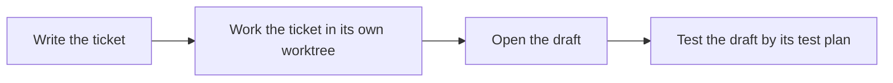

# Work a GitHub issue

How does a GitHub issue become a draft PR, and how do you plan a day of them?

The pages before this one start work from a prompt. This page starts it from an issue on a GitHub Project. Each step is a skill or a playbook of this plugin. `/engineering #<issue>` works an existing issue to a draft PR, and you review the draft.



| Element | Source |
| --- | --- |
| `issue` | [`issue`](../../skills/github/issue/SKILL.md) |
| `ticket` | [`ticket.md`](../../skills/workflow/engineering/playbooks/ticket.md) |
| `pullRequest` | [`pull-request`](../../skills/github/pull-request/SKILL.md) |
| `pullRequestReview` | [`pull-request-review`](../../skills/github/pull-request-review/SKILL.md) |

## Write the ticket

Describe the work, and ask for an issue:

```text
the csv export drops its last row since yesterday's deploy. write an issue for it.
```

The [`issue`](../../skills/github/issue/SKILL.md) skill picks the template, bug, feature, refactor, chore or epic. Where the request leaves a field open, it interviews you with the grilling skill. It writes every criterion as a checkbox, so the skills below can tick it once it is proven. It creates the issue and asks you with its link whether anything should change. Work with several parts that ship on their own becomes an epic with one sub-issue per part.

A board with the Status, Priority and Size fields comes from the [`project`](../../skills/github/project/SKILL.md) skill. Run `/project` to create one for the repository.

## Work the ticket

```text
/engineering #42
```

The [Ticket playbook](../../skills/workflow/engineering/playbooks/ticket.md) runs on its own and asks only where its steps say so.

1. It stops on a ticket that is closed, an epic, set to Blocked, assigned to someone else, or held back by an earlier ticket, and says which case applies. An earlier ticket is an open blocker, or a ticket In progress or In review with a branch in the same repository. It holds the ticket back while it has no open PR, or while the open PRs form more than one stack.
2. It takes the ticket over in its own worktree `../<repo>-<number>`, on a branch `<type>/<number>-<slug>` off `dev`, or off the default branch when the remote has no `dev`. A ticket whose earlier tickets have open PRs branches off the top one instead, so its PR becomes the next layer of a stack. Two tickets of one repository never branch off the same `dev` side by side, unless their `app: <name>` labels name no common app. The branch is created as a branch of the issue, so the issue links it and the PR opened from it. It sets the Status to In progress and assigns you.
3. It asks you through the grilling skill where a criterion reads two ways, two criteria contradict each other, or several approaches lead to a result you would see differently. It may also ask whether to set up a test runner or a verification skill.
4. It opens the playbook the label names. `bug` gives Bug fix, `refactor` gives Refactoring, and every other label gives Feature.
5. It builds each criterion in a fresh subagent, test first, with the test named after the criterion. A refactoring pins today's behaviour with a test before it changes the structure.
6. It commits criterion by criterion with the [`commit`](../../skills/git/commit/SKILL.md) skill, `Refs` on every commit and `Closes` on the last. Once a criterion's test is green and verified, it ticks the criterion in the issue.
7. It reviews the diff with [`/interrogate`](../../skills/workflow/interrogate/SKILL.md), and with [`/blast-radius`](../../skills/workflow/blast-radius/SKILL.md) when the diff changes a schema, a public API, the dependencies or a flag.
8. It runs [Opening a PR](../../skills/workflow/engineering/playbooks/pull-request.md).

A ticket that already has a branch or an open PR resumes where it stopped. A ticket that needs something outside the repository, such as an account or a secret, ends as Blocked, with the obstacle in a comment on the issue.

## Open the draft

The [`pull-request`](../../skills/github/pull-request/SKILL.md) skill opens one draft per branch against `dev` when the remote has it, otherwise against the default branch. A layer of a stack targets the branch below it, and the skill links it into the [stack](https://docs.github.com/en/pull-requests/get-started/about-stacked-prs) on GitHub with the `gh stack` extension. After a push to a lower layer it rebases the layers above. GitHub merges a stack bottom-up and moves the layers left to `dev`. Its description carries a test plan, the steps a reviewer runs in the running app before approving. When the branch changes what the application shows, the skill posts a comment with every changed screen before and after, a web application on desktop and on mobile. It rewrites that comment after each push that changes the screens. When the branch changes what code, a script or a skill outputs, the skill posts a second comment with real examples. Each changed behaviour gets a table of real inputs with the output before and after, and a Tradeoffs section lists the inputs where the new output is worse. The skill marks the draft ready for review on its own when all of these hold.

- Nothing waits for you, such as a finding marked "needs your call".
- No assumption is open.
- Every check passes. The [ci-watcher](../../agents/ci-watcher.md) agent watches them, and a failed check goes through `/loop-on-ci`.
- Every test step the agent can run itself passes.

Otherwise the PR stays a draft until you call it ready:

```text
the draft is ready
```

## Approve your own PRs

GitHub lets nobody approve their own PR. When a GitHub App of yours opens it, you can. The app is the author, you are the requested reviewer, and GitHub shows which PRs you approved and which still wait for you. Without the app the skills open the PR under your own login, as before.

1. Create the app under **Settings**, **Developer settings**, **GitHub Apps**, **New GitHub App**. Any name and homepage URL will do. Turn **Webhook** off. Under **Repository permissions** set **Contents** to Read-only, **Pull requests** to Read and write and **Issues** to Read and write. Leave **Only on this account** selected.
2. On the app's page, note the **Client ID** and under **Private keys** generate a key. The browser downloads a `.pem` file.
3. Under **Install App**, install it on your account, for all repositories or the ones the skills work in.
4. Put the key next to the configuration and write the configuration.

   ```sh
   mkdir -p ~/.config/forge
   mv ~/Downloads/<app>.*.private-key.pem ~/.config/forge/github-app.pem
   chmod 600 ~/.config/forge/github-app.pem
   cat > ~/.config/forge/github-app.json <<'EOF'
   {
     "clientId": "<client ID>",
     "privateKey": "github-app.pem"
   }
   EOF
   ```

5. Check it in a repository the app is installed on. The first command prints the app's login, the second `ghs_`, the first four characters of a token. The full token never shows up in the terminal or in a session.

   ```sh
   node skills/github/pull-request/scripts/app-token.mts --login
   node skills/github/pull-request/scripts/app-token.mts | cut -c1-4
   ```

A relative `privateKey` resolves against `~/.config/forge`, or against `$XDG_CONFIG_HOME/forge` when that is set. The [`app-token.mts`](../../skills/github/pull-request/scripts/app-token.mts) script signs a JSON Web Token with the key and trades it for an installation token of the current repository, valid for an hour. The [`pull-request`](../../skills/github/pull-request/SKILL.md) skill creates, edits, comments on and marks the PR ready with that token, and requests you as the reviewer when you named nobody else. Your commits, the push and the projects stay under your login, because GitHub gives an app no access to the projects of a user. The review that [`pull-request-review`](../../skills/github/pull-request-review/SKILL.md) posts on the app's PR is a comment of the app, so the approval and the request for changes stay yours.

## Review the PR

```text
/pull-request-review 42
```

The [`pull-request-review`](../../skills/github/pull-request-review/SKILL.md) skill checks the PR out and runs its test plan against the running app. It drives every step itself, VoiceOver included, which it reads from the accessibility tree. It hands you only the steps that need a physical device, an account it cannot get or another person, each with its reason in parentheses. Then it posts the result as a comment or a request for changes. A passed step marked `(criterion <n>)` ticks that criterion in the issue, for the criteria no test could prove. The approval stays your own click on GitHub.

## Plan a day of tickets

```text
/today-issues
```

The [`today-issues`](../../skills/github/today-issues/SKILL.md) skill reads the open tickets of the board and asks for today's three budgets: how long sessions may run, how long you answer their questions, and how long you review PRs. It also asks which Sizes run today. Naming some, such as XS and S, pulls tickets of those Sizes from Backlog too. A questions budget of none plans an auto run, which leaves out every ticket with an open decision or with work only you can do. It ranks the tickets and groups them into tracks that run side by side, one table per track. Tickets that change code in the same repository, named by their `repo: <name>` label, share a track. A ticket that does not fit a budget lands under Not today with the reason. The skill only reads, except for epics whose sub-issues are all closed. It asks you once whether to tick their success criteria and close them. Start each ticket of the plan with its URL:

```text
/engineering https://github.com/<owner>/<repo>/issues/42
```

In an auto run, add `auto`. The session then asks nothing. A ticket that needs your decision ends as Blocked, with the question in a comment on the issue. Work the ticket does not name gets no new issue right away. An agent on Fable first decides whether the work is needed and whether it belongs in this branch. Work that is not needed is dropped, work that belongs to the ticket lands in the branch, and only the rest becomes a new issue.

```text
/engineering https://github.com/<owner>/<repo>/issues/42 auto
```

Back to the [guide index](./README.md).
