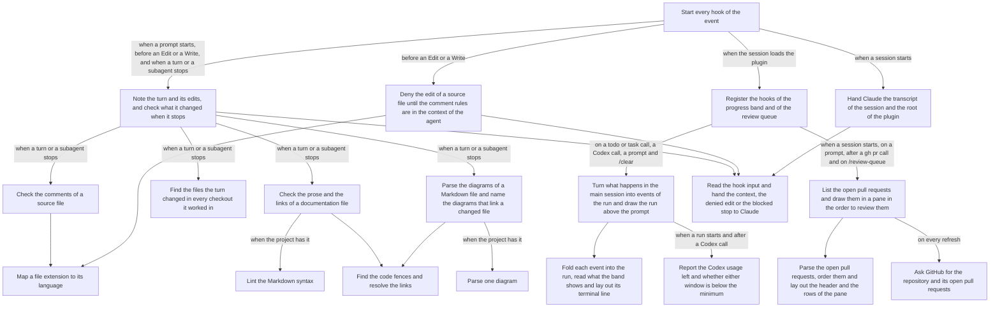

# Hooks

What happens when a session starts, while a turn runs, while Claude works through a todo list, and when the pull requests of the repository change?

| Element | Source |
| --- | --- |
| `hooksJson` | [`hooks.json`](hooks.json) |
| `sessionContext` | [`session-context.mts`](session-context.mts) |
| `loadCommentRules` | [`load-comment-rules.mts`](load-comment-rules.mts) |
| `checkTurn` | [`check-turn.mts`](check-turn.mts) |
| `changes` | [`lib/changes.mts`](lib/changes.mts) |
| `comments` | [`lib/comments.mts`](lib/comments.mts) |
| `docs` | [`lib/docs.mts`](lib/docs.mts) |
| `diagrams` | [`lib/diagrams.mts`](lib/diagrams.mts) |
| `languages` | [`lib/languages.mts`](lib/languages.mts) |
| `markdown` | [`lib/markdown.mts`](lib/markdown.mts) |
| `hook` | [`lib/hook.mts`](lib/hook.mts) |
| `module` | [`module.mts`](module.mts) |
| `progress` | [`progress/index.mts`](progress/index.mts) |
| `run` | [`progress/run.mts`](progress/run.mts) |
| `reviewQueue` | [`review-queue/index.mts`](review-queue/index.mts) |
| `order` | [`review-queue/order.mts`](review-queue/order.mts) |
| `codexModel` | [`../skills/workflow/engineering/scripts/codex-model.mts`](../skills/workflow/engineering/scripts/codex-model.mts) |

The session hook informs. `loadCommentRules` denies the edit of a source file once, until the transcript of the agent holds the comment rules and the guide of the language, and stays silent when it cannot read the transcript. The turn hook blocks the end of a turn once when a file the turn changed breaks a rule, and stays silent on the stop after it. A hook that has nothing to report prints nothing.

`progress/` is a hooks module, registered by `module.mts`. It runs inside Claude Code with no Node, keeps the run in a variable of the module and draws it above the prompt. On the terminal the band is one line, the progress such as `5/8 · Write the parser` on the left and the Codex usage such as `Codex 5h 62% · week 81%` at the right edge.

In the desktop app and on mobile the band is one row of three parts, and every color is a key of the theme.

- The count such as `5/8` comes first, beside a short bar filled to the done share of the items rounded down, in the accent color and green once every item is done.
- The title of the current item takes the free width and the surface cuts it at the width it draws, or a dim `done` stands there once every item is done.
- The Codex usage closes the row as a small caption with `Codex` and the dots between the windows dim, and the windows turn red with `below minimum` after them once either window is below the minimum.

Only `run.mts` decides what the band shows and how the terminal line reads, and `index.mts` writes the run through it alone.

`review-queue/` is a second hooks module. Claude Code loads one hooks module per plugin, so `hooks.json` names `module.mts` under `modules` and that file registers `progress/` and `review-queue/`. A hooks module registers an event without a matcher once, so `review-queue/` hooks `prompt.submit` with a matcher on the origins of a person.

`review-queue/` keeps the repository and its open pull requests in a variable of the module and draws them as the pane `Review queue · skills`, docked on the right. The engine draws that title only as a tab while a second pane is open, so the body starts with a header. On the terminal the header is one row such as `renefatuaki/skills · 3 open`, the repository in bold linking to its pull requests on GitHub and the count in dim. One row such as `3.   #42 Add the parser draft after #41` follows per pull request. `#42 Add the parser` links to the pull request and is indented two spaces for each listed pull request in the chain it waits on, a dim `draft` marks a draft and a dim `after #41` names the listed pull request this one waits on.

In the desktop app and on mobile the header is the repository as a semibold heading linking to its pull requests, with a dim caption such as `3 open · top to bottom` under it. Each row shows its position in a column as wide as the last position, one thin guide `│` for each listed pull request in the chain it waits on, a green dot for a ready pull request or a grey hollow dot for a draft, the title linking to the pull request, a small dim `Draft` for a draft and the dim number such as `#42` at the right edge. The surface cuts the title at the width it draws, and the row under the pointer is highlighted. Every color is a key of the theme, so the pane follows a light and a dark theme. Only `order.mts` decides the order and the texts of the header and the rows, and `index.mts` writes the repository and the list through `refresh` alone.

- A pull request comes after another when its base branch is the head branch of that one, or when one of its closing issues is blocked by an open issue that the other one closes. Each stack is listed in one piece, depth first. The next pull request is the free one that waits on the pull request listed most recently. Of two such children the one with fewer pull requests after it comes first, so a single pull request comes before a long chain. Stacks among themselves and children with subtrees of the same size go ready before draft, then the oldest, then the lower number. A cycle drops no pull request.
- The pane opens on its own when a session starts and after each refresh while open pull requests exist, and closes when there are none. The list refreshes when a session starts, on each prompt of a person and after a successful Bash call whose command contains `gh pr` and a subcommand, of Claude or of a subagent. `/review-queue` refreshes the list and opens the pane by hand.
- Claude Code places a pane that a plugin opens on its own only from 144 terminal columns, and `/review-queue` places it at any width.
- `gh` has to be signed in. Without `gh`, outside a GitHub repository or on any failure the list is empty, the pane closes and no error shows.
- Claude Code offers the todo and task tools by default only on Opus 4.7, Sonnet 4.6, Haiku 4.5 and earlier models, so on any other model the band stays empty unless [`CLAUDE_CODE_ENABLE_TODO_TOOLS=1`](https://code.claude.com/docs/en/tools-reference.md#task-tool-availability) is set.
- The turn hook keeps a journal per session in the temporary folder of the user, never in a working tree. It holds the start of the current turn, the state of each checkout the turn works in and the content of each file before an Edit or a Write touches it. Each prompt replaces the journal by a new one in a single rename, so it holds one turn.
- The journal folder must belong to the user and be closed to other users, and the hook never follows a link to a journal. Otherwise it keeps no journal and a stop stays silent.
- A stop compares the content of every candidate file with its content at the start of the turn, the way git stores it, so line-ending and other filters of the checkout change nothing. An Edit, a shell command, a commit, an amend, a rebase and a cherry-pick count alike. A commit counts by its committer date, so a file that a checkout or a pull brought in does not.
- The rules of a file below the working directory resolve against the working directory, so a session in a package of a monorepo finds its `docs` folder, its README table and its markdownlint configuration there. A file outside it, in another checkout, resolves against the git top level of that checkout.
- A worktree the turn creates after its prompt starts in the state it was created in, and so does the worktree of a subagent, whenever the subagent started. A subagent with its own worktree is checked when it stops, also from another repository. The stop of the main session leaves that worktree out.
- A stop starts no git call and no new file after 25 seconds, gives each git call the time that is left as its timeout, and names the files and the checkouts it left in one line. `FORGE_CHECK_BUDGET_MS` sets the budget in milliseconds, an empty value keeps the default, and the turn test uses it.
- A rule set that fails costs only its own findings. The reason then says which rule set could not run and why.
- Paths are resolved through symbolic links, so one checkout reached by two names is one checkout.
- [markdownlint](https://raw.githubusercontent.com/DavidAnson/markdownlint/main/README.md) and [Mermaid](https://raw.githubusercontent.com/mermaid-js/mermaid/develop/docs/config/usage.md) come from the project that is edited, never from this plugin.
- [Claude Code hooks](https://code.claude.com/docs/en/hooks.md) describes the input a hook reads and the output it writes.
- [Claude Code mods](https://code.claude.com/docs/en/plugins/mods/overview.md) describes a hooks module, the events it hooks and the band above the prompt.
