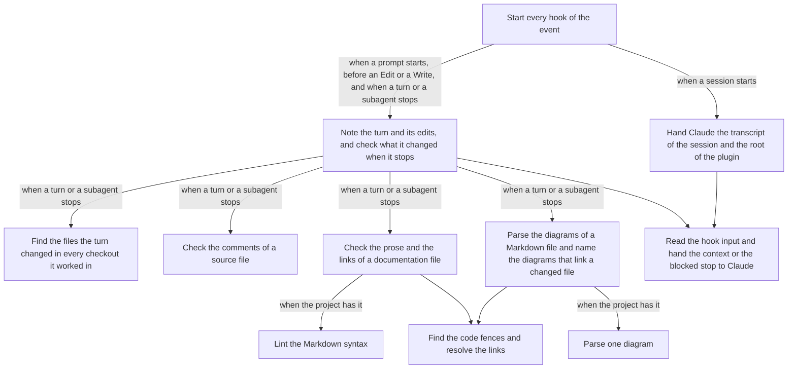

# Hooks

What happens when a session starts and while a turn runs?

| Element | Source |
| --- | --- |
| `hooksJson` | [`hooks.json`](hooks.json) |
| `sessionContext` | [`session-context.mts`](session-context.mts) |
| `checkTurn` | [`check-turn.mts`](check-turn.mts) |
| `changes` | [`lib/changes.mts`](lib/changes.mts) |
| `comments` | [`lib/comments.mts`](lib/comments.mts) |
| `docs` | [`lib/docs.mts`](lib/docs.mts) |
| `diagrams` | [`lib/diagrams.mts`](lib/diagrams.mts) |
| `markdown` | [`lib/markdown.mts`](lib/markdown.mts) |
| `hook` | [`lib/hook.mts`](lib/hook.mts) |

The session hook informs. The turn hook blocks the end of a turn once when a file the turn changed breaks a rule, and stays silent on the stop after it. A hook that has nothing to report prints nothing.

- The turn hook keeps a journal per session in the temporary folder of the user, never in a working tree. It holds the start of the current turn, the state of each checkout the turn works in and the content of each file before an Edit or a Write touches it. Each prompt replaces the journal by a new one in a single rename, so it holds one turn.
- The journal folder must belong to the user and be closed to other users, and the hook never follows a link to a journal. Otherwise it keeps no journal and a stop stays silent.
- A stop compares the content of every candidate file with its content at the start of the turn, the way git stores it, so line-ending and other filters of the checkout change nothing. An Edit, a shell command, a commit, an amend, a rebase and a cherry-pick count alike. A commit counts by its committer date, so a file that a checkout or a pull brought in does not.
- The rules of a file below the working directory resolve against the working directory, so a session in a package of a monorepo finds its `docs` folder, its README table and its markdownlint configuration there. A file outside it, in another checkout, resolves against the git top level of that checkout.
- A worktree the turn creates after its prompt starts in the state it was created in, and so does the worktree of a subagent, whenever the subagent started. A subagent with its own worktree is checked when it stops, also from another repository. The stop of the main session leaves that worktree out.
- A stop starts no new file after 25 seconds and names the files it left. `FORGE_CHECK_BUDGET_MS` sets the budget in milliseconds, the turn test uses it.
- [markdownlint](https://raw.githubusercontent.com/DavidAnson/markdownlint/main/README.md) and [Mermaid](https://raw.githubusercontent.com/mermaid-js/mermaid/develop/docs/config/usage.md) come from the project that is edited, never from this plugin.
- [Claude Code hooks](https://code.claude.com/docs/en/hooks.md) describes the input a hook reads and the output it writes.
