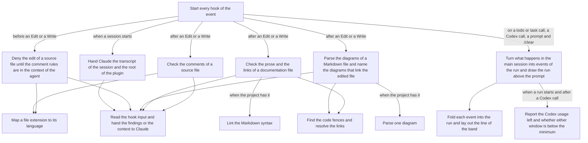

# Hooks

What happens when a session starts, before and after Claude edits a file, and while Claude works through a todo list?

| Element | Source |
| --- | --- |
| `hooksJson` | [`hooks.json`](hooks.json) |
| `sessionContext` | [`session-context.mts`](session-context.mts) |
| `loadCommentRules` | [`load-comment-rules.mts`](load-comment-rules.mts) |
| `checkComments` | [`check-comments.mts`](check-comments.mts) |
| `checkDocs` | [`check-docs.mts`](check-docs.mts) |
| `checkDiagrams` | [`check-diagrams.mts`](check-diagrams.mts) |
| `languages` | [`lib/languages.mts`](lib/languages.mts) |
| `markdown` | [`lib/markdown.mts`](lib/markdown.mts) |
| `hook` | [`lib/hook.mts`](lib/hook.mts) |
| `progress` | [`progress/index.mts`](progress/index.mts) |
| `run` | [`progress/run.mts`](progress/run.mts) |
| `codexModel` | [`../skills/workflow/engineering/scripts/codex-model.mts`](../skills/workflow/engineering/scripts/codex-model.mts) |

Every hook informs and never blocks a session, an edit or a tool call, except `loadCommentRules`. It denies the edit of a source file once, until the transcript of the agent holds the comment rules and the guide of the language, and stays silent when it cannot read the transcript. A hook that has nothing to report prints nothing.

`progress/` is a hooks module, named under `modules` in `hooks.json`. It runs inside Claude Code with no Node, keeps the run in a variable of the module and draws one line above the prompt, the progress such as `5/8 · Write the parser` on the left and the Codex usage such as `Codex 5h 62% · week 81%` at the right edge. Only `run.mts` decides what the line shows, and `index.mts` writes the run through it alone.

- Claude Code offers the todo and task tools by default only on Opus 4.7, Sonnet 4.6, Haiku 4.5 and earlier models, so on any other model the band stays empty unless [`CLAUDE_CODE_ENABLE_TODO_TOOLS=1`](https://code.claude.com/docs/en/tools-reference.md#task-tool-availability) is set.
- [markdownlint](https://raw.githubusercontent.com/DavidAnson/markdownlint/main/README.md) and [Mermaid](https://raw.githubusercontent.com/mermaid-js/mermaid/develop/docs/config/usage.md) come from the project that is edited, never from this plugin.
- [Claude Code hooks](https://code.claude.com/docs/en/hooks.md) describes the input a hook reads and the output it writes.
- [Claude Code mods](https://code.claude.com/docs/en/plugins/mods/overview.md) describes a hooks module, the events it hooks and the band above the prompt.
