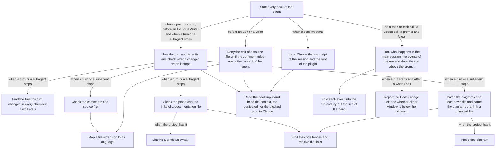

# Hooks

What happens when a session starts, while a turn runs, and while Claude works through a todo list?

| Element | Source |
| --- | --- |
| `hooksJson` | [`hooks.json`](hooks.json) |
| `sessionContext` | [`session-context.mts`](session-context.mts) |
| `loadCommentRules` | [`load-comment-rules.mts`](load-comment-rules.mts) |
| `checkTurn` | [`check-turn.mts`](check-turn.mts) |
| `changes` | [`lib/changes.mts`](lib/changes.mts) |
| `comments` | [`lib/comments.mts`](lib/comments.mts) |
| `docs` | [`lib/docs.mts`](lib/docs.mts) |
| `diagrams` | [`lib/diagrams.mts`](lib/diagrams.mts) |
| `languages` | [`lib/languages.mts`](lib/languages.mts) |
| `markdown` | [`lib/markdown.mts`](lib/markdown.mts) |
| `hook` | [`lib/hook.mts`](lib/hook.mts) |
| `progress` | [`progress/index.mts`](progress/index.mts) |
| `run` | [`progress/run.mts`](progress/run.mts) |
| `codexModel` | [`../skills/workflow/engineering/scripts/codex-model.mts`](../skills/workflow/engineering/scripts/codex-model.mts) |

The session hook informs. `loadCommentRules` denies the edit of a source file once, until the transcript of the agent holds the comment rules and the guide of the language, and stays silent when it cannot read the transcript. The turn hook blocks the end of a turn once when a file the turn changed breaks a rule, and stays silent on the stop after it. A hook that has nothing to report prints nothing.

`progress/` is a hooks module, named under `modules` in `hooks.json`. It runs inside Claude Code with no Node, keeps the run in a variable of the module and draws one line above the prompt, the progress such as `5/8 · Write the parser` on the left and the Codex usage such as `Codex 5h 62% · week 81%` at the right edge. Only `run.mts` decides what the line shows, and `index.mts` writes the run through it alone.

- Claude Code offers the todo and task tools by default only on Opus 4.7, Sonnet 4.6, Haiku 4.5 and earlier models, so on any other model the band stays empty unless [`CLAUDE_CODE_ENABLE_TODO_TOOLS=1`](https://code.claude.com/docs/en/tools-reference.md#task-tool-availability) is set.
- The turn hook keeps a journal per session in the temporary folder of the user, never in a working tree. It holds the start of the current turn, the state of each checkout the turn works in and the content of each file before an Edit or a Write touches it. Each prompt replaces the journal by a new one in a single rename, so it holds one turn.
- The journal folder must belong to the user and be closed to other users, and the hook never follows a link to a journal. Otherwise it keeps no journal and a stop stays silent.
- A stop compares the content of every candidate file with its content at the start of the turn, the way git stores it, so line-ending and other filters of the checkout change nothing. An Edit, a shell command, a commit, an amend, a rebase and a cherry-pick count alike. A commit counts by its committer date, so a file that a checkout or a pull brought in does not.
- The rules of a file below the working directory resolve against the working directory, so a session in a package of a monorepo finds its `docs` folder, its README table and its markdownlint configuration there. A file outside it, in another checkout, resolves against the git top level of that checkout.
- A worktree the turn creates after its prompt starts in the state it was created in, and so does the worktree of a subagent, whenever the subagent started. A subagent with its own worktree is checked when it stops, also from another repository. The stop of the main session leaves that worktree out.
- A stop starts no git call and no new file after 25 seconds, gives each git call the time that is left as its timeout, and names the files and the checkouts it left in one line. `FORGE_CHECK_BUDGET_MS` sets the budget in milliseconds, an empty value keeps the default, and the turn test uses it.
- A rule set that fails costs only its own findings. The reason then says which rule set could not run and why.
- Paths are resolved through symbolic links, so one checkout reached by two names is one checkout.
- [markdownlint](https://raw.githubusercontent.com/DavidAnson/markdownlint/main/README.md) and [Mermaid](https://raw.githubusercontent.com/mermaid-js/mermaid/develop/docs/config/usage.md) come from the project that is edited, never from this plugin.
- [Claude Code hooks](https://code.claude.com/docs/en/hooks.md) describes the input a hook reads and the output it writes.
- [Claude Code mods](https://code.claude.com/docs/en/plugins/mods/overview.md) describes a hooks module, the events it hooks and the band above the prompt.
