# Hooks

What happens when a session starts, while a turn runs, while Claude works through a todo list, and when the key of the prompt optimizer is pressed?

```mermaid
%%{init: {"htmlLabels": false}}%%
flowchart TD
  accTitle: What happens when a session starts, while a turn runs, while Claude works through a todo list, and when the key of the prompt optimizer is pressed?
  hooksJson["Start every hook of the event"]
  hooksJson -->|"when a session starts"| sessionContext["Hand Claude the transcript of the session and the root of the plugin"]
  hooksJson -->|"before an Edit or a Write"| loadCommentRules["Deny the edit of a source file until the comment rules are in the context of the agent"]
  hooksJson -->|"before a Bash command"| checkDiagramLabels["Deny a gh command whose text holds a diagram that draws HTML labels"]
  hooksJson -->|"before a Bash command"| checkPullRequestAuthor["Deny a gh command that opens a pull request without the token of the GitHub App"]
  hooksJson -->|"when a prompt starts, before and after an Edit or a Write, and when a turn or a subagent stops"| checkTurn["Note the turn and its edits, check the file an edit just wrote, and check what the turn changed when it stops"]
  hooksJson -->|"when Claude Code loads the plugin"| module["Register the hooks of the progress band and of the prompt optimizer, and join what the two draw into the one row above the prompt"]
  module -->|"when a session starts, on a todo or task call, a Codex call, an Antigravity call, a prompt, a usage measurement, a context measurement and /clear"| progress["Turn what happens in the main session into events of the run and draw the run above the prompt"]
  module -->|"on each edit of the draft, on a prompt and on the key of the prompt optimizer"| promptOptimizer["Rewrite the draft in the prompt box into a clearer prompt and draw the trigger above the prompt"]
  checkTurn -->|"when a turn or a subagent stops"| changes["Find the files the turn changed in every checkout it worked in"]
  checkTurn -->|"after an Edit or a Write, and when a turn or a subagent stops"| comments["Check the comments of a source file"]
  checkTurn -->|"after an Edit or a Write, and when a turn or a subagent stops"| docs["Check the prose and the links of a documentation file"]
  checkTurn -->|"when a turn or a subagent stops"| diagrams["Parse the diagrams of a Markdown file, check that each one draws SVG labels and name the diagrams that link a changed file"]
  docs -->|"when the project has it"| markdownlint["Lint the Markdown syntax"]
  diagrams -->|"when the project has it"| mermaid["Parse one diagram"]
  docs --> markdown["Find the code fences and resolve the links"]
  diagrams --> markdown
  comments --> languages["Map a file extension to its language"]
  loadCommentRules --> languages
  checkTurn --> hook["Read the hook input and hand the context, the denied edit or the blocked stop to Claude"]
  loadCommentRules --> hook
  checkDiagramLabels --> hook
  checkDiagramLabels --> diagrams
  checkPullRequestAuthor --> hook
  checkPullRequestAuthor --> githubApp["Find the folder of the configuration of the GitHub App"]
  sessionContext --> hook
  progress --> run["Fold each event into the run, read what the band shows and lay out its terminal line"]
  progress -->|"when a session starts, on each prompt and after a Codex call"| codexModel["Report the Codex usage left and whether either window is below the minimum"]
  progress -->|"when a session starts, on each prompt and after an Antigravity call"| antigravity["Report the Antigravity usage left of each Gemini group and whether any is below the minimum"]
```

| Element | Source |
| --- | --- |
| `hooksJson` | [`hooks.json`](hooks.json) |
| `sessionContext` | [`session-context.mts`](session-context.mts) |
| `loadCommentRules` | [`load-comment-rules.mts`](load-comment-rules.mts) |
| `checkDiagramLabels` | [`check-diagram-labels.mts`](check-diagram-labels.mts) |
| `checkPullRequestAuthor` | [`check-pull-request-author.mts`](check-pull-request-author.mts) |
| `githubApp` | [`../skills/github/pull-request/scripts/github-app.mts`](../skills/github/pull-request/scripts/github-app.mts) |
| `checkTurn` | [`check-turn.mts`](check-turn.mts) |
| `changes` | [`lib/changes.mts`](lib/changes.mts) |
| `comments` | [`lib/comments.mts`](lib/comments.mts) |
| `docs` | [`lib/docs.mts`](lib/docs.mts) |
| `diagrams` | [`lib/diagrams.mts`](lib/diagrams.mts) |
| `languages` | [`lib/languages.mts`](lib/languages.mts) |
| `markdown` | [`lib/markdown.mts`](lib/markdown.mts) |
| `hook` | [`lib/hook.mts`](lib/hook.mts) |
| `module` | [`module.mts`](module.mts) |
| `progress` | [`progress/index.mts`](progress/index.mts) |
| `run` | [`progress/run.mts`](progress/run.mts) |
| `codexModel` | [`../skills/workflow/engineering/scripts/codex-model.mts`](../skills/workflow/engineering/scripts/codex-model.mts) |
| `antigravity` | [`../skills/workflow/engineering/scripts/antigravity-model.mts`](../skills/workflow/engineering/scripts/antigravity-model.mts) |
| `promptOptimizer` | [`prompt-optimizer/README.md`](prompt-optimizer/README.md) |

The session hook informs. `loadCommentRules` denies the edit of a source file once, until the transcript of the agent holds the comment rules and the guide of the language, and stays silent when it cannot read the transcript. `checkDiagramLabels` denies a `gh` command whose text, such as the body of a pull request, an issue or a comment, holds a `flowchart`, a `stateDiagram-v2` or a `classDiagram` without the line `%%{init: {"htmlLabels": false}}%%`, because that text reaches GitHub without a file the turn hook could check. `checkPullRequestAuthor` denies a `gh pr create` that no `GH_TOKEN` assignment precedes when `~/.config/forge/github-app.json` exists, because the pull request would carry the user as its author and the user could not approve it. The turn hook hands Claude the findings for a file right after an Edit, a Write or a MultiEdit as additional context, old lines included, so Claude fixes them while the file is open. It runs the rule sets of the stop except the diagrams that link a changed file, which wait for the stop. It blocks the end of a turn once when a file the turn changed breaks a rule, and Claude then fixes the lines and continues the task where it stopped. It stays silent on the stop after it. A hook that has nothing to report prints nothing.

`module.mts` is the hooks module of the plugin, named under `modules` in `hooks.json`, which takes one module per plugin. It runs inside Claude Code with no Node and registers the hooks of `progress/` and of `prompt-optimizer/`. A hooks module takes each event once and a plugin has one row above the prompt. So `module.mts` itself hooks the prompt and the band, hands the prompt to both parts and puts the trigger of the prompt optimizer at the left end of the row, before the progress band.

`prompt-optimizer/` rewrites the draft in the prompt box into a clearer prompt on `ctrl+x b` and never sends it. [prompt-optimizer/README.md](prompt-optimizer/README.md) shows what the key does and how to move it to another key.

`progress/` keeps the run in a variable of the module and draws it above the prompt. Each part of the band shows only when it has something to show, and with none the band draws nothing.

On the terminal the band is one line.

- The progress such as `5/8 · Write the parser` stands at the left edge.
- The usages stand side by side at the right edge, three columns apart, the Claude usage first.
- The Claude usage reads `Claude Context 34% · 5h 77%`. The context reading comes first and shows the share of the context window the session has used, where every other reading shows the share left. With no context figure yet, in a fresh session or just after a compaction, the reading is left out and the usage reads `Claude 5h 77%`. Off a subscription it reads `Claude Context 34%` alone.
- An account with no 5-hour window reads `Claude Context 34% · week 67% · Fable 57%` instead, the context before its weekly window and the weekly limit of each model.
- The Codex usage such as `Codex 5h 62% · week 81%` follows it, then the Antigravity usage such as `Antigravity week 91%`.
- A narrow line cuts the title first, then leaves out the Antigravity usage once the title would vanish, then the Codex usage by the same rule, and leaves out the Claude usage last.

| Part | What it shows | When the module reads it |
| --- | --- | --- |
| Claude usage | The share of the context window the session has used, then the share left of the 5-hour window of the Claude subscription, rounded down. An account with no 5-hour window shows the share left of its weekly window and of the weekly limit of each model by the name of the model | When the session starts, on each measurement that moved the context, and on each measurement that moved a rate-limit window |
| Codex usage | The share left of the 5-hour and the weekly Codex window, as `codexModel` reports it | When the session starts, on every prompt that is not a meta prompt and after each Codex call |
| Antigravity usage | The share left of each Gemini group, the tightest limit of the group, as `antigravity` reports it | When the session starts, on every prompt that is not a meta prompt and after each `antigravity:antigravity-rescue` call |

Off a subscription Claude Code has no rate-limit reading, so the Claude usage holds the context alone. Before the first response of the context window it has no context figure either, so the Claude usage stays hidden unless a rate-limit window is read.

The windows come from the rate-limit reading of Claude Code. The weekly limit of each model is not part of that reading, so an account with no 5-hour window asks the usage endpoint of Anthropic for it with the login of the session, at the same moments. With no first-party login, a refused request or a body the band cannot read, the band shows the weekly window alone. An account with a 5-hour window never asks the endpoint.

The reads of the two providers run side by side and each one draws as soon as its script answers, so a slow `agy` never delays the Codex usage. A script that fails hides only its own usage.

The Antigravity usage names each limit by its Gemini group.

- One group reads `week`, because every group of `/usage` has a weekly limit today. The text is `Antigravity week 91%`.
- Several groups read by a short name taken from the group name. The words `Gemini` and `Models` and version numbers are left out, so `Gemini Models` reads `Gemini` and `Gemini 4 Argon` reads `Argon`. The text is `Antigravity Gemini 91% · Argon 40%`.
- A limit below the minimum turns the usage red and adds `(below minimum)`, like the Codex usage.

In the desktop app and on mobile the band is one row of up to five parts, and every color is a key of the theme. With no todo list open the row holds only the captions of the usages at its right end.

- The count such as `5/8` follows, beside a short bar filled to the done share of the items rounded down, in the accent color and green once every item is done.
- The title of the current item takes the free width and the surface cuts it at the width it draws, or a dim `done` stands there once every item is done.
- The usages close the row, each as a small caption, the Claude caption first, then the Codex caption and the Antigravity caption, all built by the same function. A caption has the provider name and the dots between its readings dim. The readings turn red with `below minimum` after them once a limit of the provider is below the minimum.

Only `run.mts` decides what the band shows and how the terminal line reads, and `index.mts` writes the run through it alone.

- Claude Code offers the todo and task tools by default only on Opus 4.7, Sonnet 4.6, Haiku 4.5 and earlier models, so on any other model the progress part stays empty unless [`CLAUDE_CODE_ENABLE_TODO_TOOLS=1`](https://code.claude.com/docs/en/tools-reference.md#task-tool-availability) is set. The Claude usage and the usages of the providers show without it.
- The turn hook keeps a journal per session in the temporary folder of the user, never in a working tree. It holds the start of the current turn, the state of each checkout the turn works in and the content of each file before an Edit or a Write touches it. Each prompt replaces the journal by a new one in a single rename, so it holds one turn.
- The journal folder must belong to the user and be closed to other users, and the hook never follows a link to a journal. Otherwise it keeps no journal and a stop stays silent.
- A stop compares the content of every candidate file with its content at the start of the turn, the way git stores it, so line-ending and other filters of the checkout change nothing. An Edit, a shell command, a commit, an amend, a rebase and a cherry-pick count alike. A commit counts by its committer date, so a file that a checkout or a pull brought in does not.
- The rules of a file below the working directory resolve against the working directory, so a session in a package of a monorepo finds its `docs` folder, its README table and its markdownlint configuration there. A file outside it, in another checkout, resolves against the git top level of that checkout.
- A worktree the turn creates after its prompt starts in the state it was created in, and so does the worktree of a subagent, whenever the subagent started. A subagent with its own worktree is checked when it stops, also from another repository. The stop of the main session leaves that worktree out.
- A stop and an edit start no git call and no new file after 25 seconds. A stop gives each git call the time that is left as its timeout and names the files and the checkouts it left in one line. An edit says nothing about what it left, because the stop checks it again. `FORGE_CHECK_BUDGET_MS` sets the budget in milliseconds, an empty value keeps the default, and the turn test uses it.
- A rule set that fails costs only its own findings. The reason then says which rule set could not run and why.
- Paths are resolved through symbolic links, so one checkout reached by two names is one checkout.
- [markdownlint](https://raw.githubusercontent.com/DavidAnson/markdownlint/main/README.md) and [Mermaid](https://raw.githubusercontent.com/mermaid-js/mermaid/develop/docs/config/usage.md) come from the project that is edited, never from this plugin.
- [Claude Code hooks](https://code.claude.com/docs/en/hooks.md) describes the input a hook reads and the output it writes.
- [Claude Code mods](https://code.claude.com/docs/en/plugins/mods/overview.md) describes a hooks module, the events it hooks and the band above the prompt.
