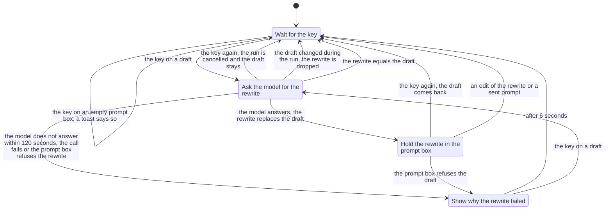

# Prompt optimizer

What does the key of the prompt optimizer do with the draft in the prompt box?

| Term | Meaning |
| --- | --- |
| Draft | The unsent text in the prompt box |
| Rewrite | The clearer prompt for the same request that a Claude model writes from the draft |
| Key | The keys bound to the action `app:cycleDiffBase`, `ctrl+x b` by default |
| Trigger | What the band above the prompt draws for the key, a dim line on the terminal and a button in the desktop app and on mobile |



| Element | Source |
| --- | --- |
| `idle` | [`IDLE`](index.mts) |
| `optimizing` | [`startRun`](index.mts) |
| `optimized` | [`land`](index.mts) |
| `failed` | [`fail`](index.mts) |

A draft `fix bug` runs through the states like this.

1. `ctrl+x b` starts the run, and the trigger reads `optimizing… (ctrl+x b cancels)`.
2. The model answers `Fix the failing login test.`, the prompt box holds that text, and the trigger reads `undo optimize (ctrl+x b)`.
3. `ctrl+x b` again puts `fix bug` back.

The key never sends the prompt. You read the rewrite, change it if you want to, and send it with Enter.

| Surface | Trigger | You press it with |
| --- | --- | --- |
| Terminal | A dim line such as `optimize prompt (ctrl+x b)`, shown while the prompt box holds a draft, a run is going or a failure shows | The key, from the prompt |
| Desktop app and mobile | A button `Optimize prompt`, shown on an empty prompt box too | A click or a tap |

- The model of the session writes the rewrite at low effort, with the session before the draft, so it knows what `the second one` refers to. Before the first request of a session and right after `/clear`, Sonnet writes it from the draft alone.
- The rewrite keeps the language of the draft and every fact, path, code block and slash command in it. [`optimizer-prompt.mts`](optimizer-prompt.mts) holds the rules, taken from [Prompting best practices](https://platform.claude.com/docs/en/build-with-claude/prompt-engineering/claude-prompting-best-practices.md).
- A failure shows its reason next to the trigger for 6 seconds, in the error color.

## Move it to another key

The key is the one Claude Code binds to `app:cycleDiffBase`, because the trigger can only take an action that Claude Code already has. [Customize keyboard shortcuts](https://code.claude.com/docs/en/keybindings.md) describes the file and the names of the keys.

1. Bind the action to your key in `~/.claude/keybindings.json`, in the `Global` context. A binding in the `Chat` context does not reach the trigger.

   ```json
   {
     "bindings": [
       {
         "context": "Global",
         "bindings": {
           "meta+i": "app:cycleDiffBase"
         }
       }
     ]
   }
   ```

2. For a key with Option on macOS, turn on Option as Meta in the terminal, as [Enable Option key shortcuts on macOS](https://code.claude.com/docs/en/terminal-config.md#enable-option-key-shortcuts-on-macos) describes.
3. In the VS Code terminal with a keyboard layout that types `@` or brackets with Option, leave Option as Meta off and send the key with a binding in the `keybindings.json` of VS Code instead. Those characters then keep working.

   ```json
   {
     "key": "alt+[KeyI]",
     "command": "workbench.action.terminal.sendSequence",
     "args": {
       "text": "\u001bi"
     },
     "when": "terminalFocus"
   }
   ```

4. Run `/config` and set **Chord of the prompt optimizer** to the name of your key, such as `option+i`. The trigger shows that text. It is a label and binds nothing.

## Limits

- While the diff panel of `/diff` is open, the key cycles the comparison base of the panel and does not reach the prompt optimizer.
- The button in the desktop app and on mobile works only where the app hands the prompt box to mods.
- A session with a survey above the prompt shows no trigger until the survey is gone.
- This plugin has one row above the prompt, so the trigger stands under the [progress band](../README.md).
