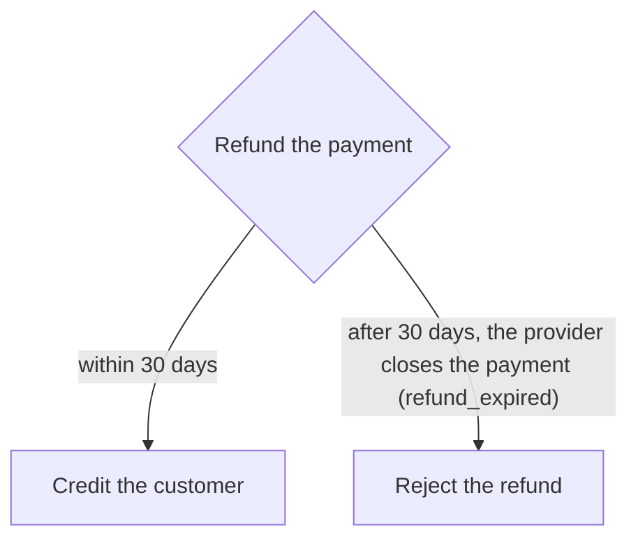

# Refund

How does a refund get back to the customer?

| Element | Source |
| --- | --- |
| `refundPayment` | [`refundPayment`](../refund.ts) |
| `creditCustomer` | [`creditCustomer`](../refund.ts) |
| `rejectRefund` | [`rejectRefund`](../refund.ts) |
